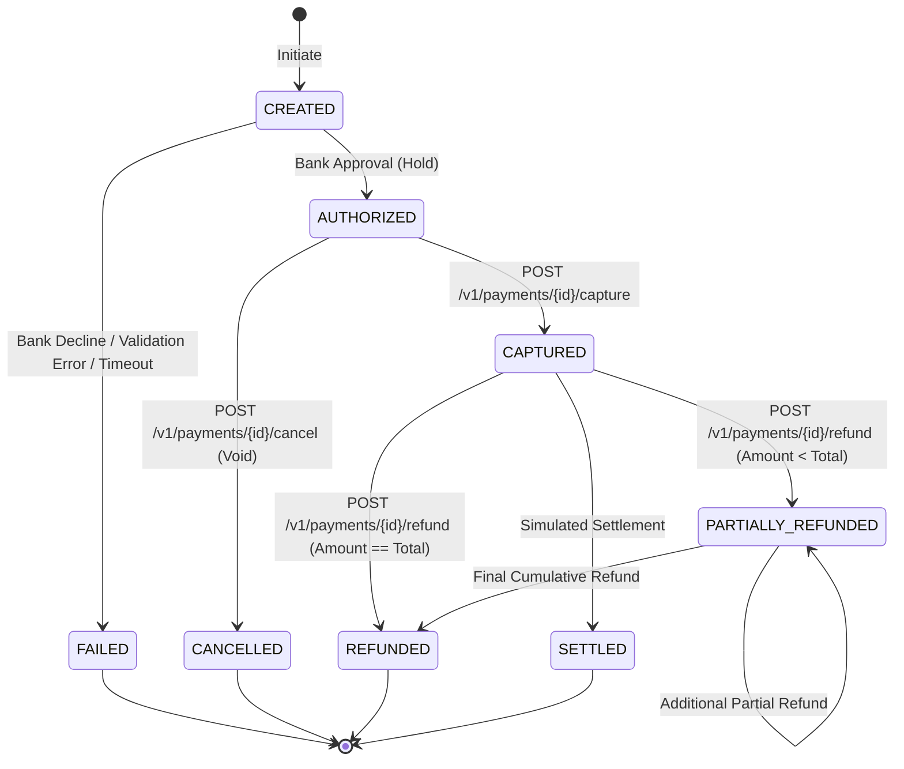

# 01 - Project Requirements Document (PRD)

**Project Name:** Payment Gateway Reliability & Quality Engineering Framework  
**Document Version:** 1.1.0 (Post-Architecture Review Updates)  
**Target Environment:** Windows 11, Python 3.12 (`py -3.12`), Local Educational Simulation  
**Classification:** Quality Engineering & Systems Architecture Specification  

---

## 1. Executive Summary & Objective

In modern financial technology, payment gateway failures directly result in monetary loss, regulatory penalties, reconciliation discrepancies, and severe brand damage. While building a standard CRUD API is straightforward, validating the **reliability, idempotency, state consistency, concurrency safety, and failure recovery** of a payment system requires specialized Software Quality Engineering (QE).

The primary deliverable of this project is **not merely a payment application**, but an **independent, enterprise-grade Quality Engineering & Automated Testing Framework**. The framework treats the payment service as a decoupled System Under Test (SUT), validating both external API contracts and internal data integrity (SQL ledger balances, idempotency records, and state transitions).

> **Safety Notice:** This system is an isolated, local educational simulation. It strictly prohibits the use of real financial credentials, live credit card numbers, or live banking APIs. All card numbers and bank responses are generated synthetically using deterministic test patterns.

---

## 2. Stakeholders & System Roles

1. **Merchant / Client Application:** Consumes the payment API to create charges, capture funds, and issue refunds using client-supplied idempotency tokens.
2. **Payment Gateway (SUT):** The core FastAPI application managing the payment state machine, validating requests, enforcing idempotency, recording a genuine double-entry audit ledger, and dispatching signed webhooks.
3. **Simulated Acquirer / Core Banking Processor:** An internal simulation module that mimics card network authorization, fraud screening, bank latency, and simulated decline codes (e.g., `INSUFFICIENT_FUNDS`, `DO_NOT_HONOR`, `NETWORK_TIMEOUT`).
4. **Independent QA Automation Framework:** The decoupled test harness (Pytest, HTTPX, direct SQL verifiers, JMeter) that executes functional, integration, database assertion, concurrency stress, and contract tests against the SUT.

---

## 3. Payment Lifecycle & State Machine Specification

A payment transaction undergoes rigorous lifecycle state changes. Every transition must be atomic, deterministic, and auditable.

### 3.1 Strict State Transition Matrix

The table below outlines all valid and invalid transitions:

| From State | Allowed Target State | Triggering Operation | Invalid Target States (Returns HTTP 409 Conflict) |
| :--- | :--- | :--- | :--- |
| **`CREATED`** | `AUTHORIZED`, `FAILED` | Internal Auth processing | `CAPTURED`, `CANCELLED`, `REFUNDED`, `SETTLED` |
| **`AUTHORIZED`** | `CAPTURED`, `CANCELLED` | `/capture` or `/cancel` | `CREATED`, `FAILED`, `REFUNDED`, `SETTLED`, `AUTHORIZED` |
| **`CAPTURED`** | `PARTIALLY_REFUNDED`, `REFUNDED`, `SETTLED` | `/refund` or batch | `CREATED`, `AUTHORIZED`, `CANCELLED`, `FAILED`, `CAPTURED` |
| **`PARTIALLY_REFUNDED`** | `PARTIALLY_REFUNDED`, `REFUNDED` | `/refund` | `CREATED`, `AUTHORIZED`, `CANCELLED`, `CAPTURED` |
| **`REFUNDED`** | *None (Terminal)* | Terminal | Any transition rejected with HTTP 409 |
| **`CANCELLED`** | *None (Terminal)* | Terminal | Any transition rejected with HTTP 409 |
| **`FAILED`** | *None (Terminal)* | Terminal | Any transition rejected with HTTP 409 |
| **`SETTLED`** | `PARTIALLY_REFUNDED`, `REFUNDED` | `/refund` | `CREATED`, `AUTHORIZED`, `CANCELLED`, `CAPTURED` |

**Invalid Transition Handling:**  
When an invalid transition is attempted (e.g., calling `/capture` on a `CANCELLED` or already `CAPTURED` payment), the gateway strictly rejects the request with **`HTTP 409 Conflict`** and an error code of `invalid_state_transition`, leaving the database record unmodified.

---

## 4. Testable Business Rules & Edge Cases

### BR-01: Precise Idempotency Behaviour
Every mutating request (`POST`) accepts an `Idempotency-Key` header (UUID or string). The gateway enforces three exact rules:
1. **Same Key + Same Payload:** The gateway bypasses re-execution and immediately returns the **original transaction result** (HTTP status and cached response body). No duplicate charges or ledger entries occur.
2. **Same Key + Different Payload:** The gateway strictly rejects the request with **`HTTP 409 Conflict`** and error code `idempotency_payload_mismatch`. It does NOT execute the transaction and does NOT overwrite the original record.
3. **Different Keys:** Treated as completely **independent transaction attempts**, even if the payment details (amount, card) happen to match.
4. **Concurrent In-Flight Requests:** If a request arrives with an idempotency key that is currently locked in `IN_PROGRESS` status by another thread, the gateway returns **`HTTP 409 Conflict`** with error code `concurrent_mutation_in_progress`.
5. **Key Expiration (TTL):** Idempotency records remain cached for 24 hours.

### BR-02: Strict Amount & Currency Validation
- **Integer Minor Units:** All monetary amounts are handled strictly in the smallest currency sub-unit (integer cents, e.g. `$10.00` is represented as `1000`). Floating-point inputs are rejected at schema validation.
- **Minimum Amount:** Must be $\ge 50$ minor units ($0.50). Values $< 50$ return **`HTTP 400 Bad Request`** (`amount_below_minimum`).
- **Maximum Amount:** Single transaction limit is $\$100,000.00$ (`10,000,000` cents). Values exceeding this return **`HTTP 400 Bad Request`** (`amount_exceeds_transaction_limit`).
- **Supported Currencies:** ISO 4217 standard (`USD`, `EUR`, `GBP`, `CAD`, `INR`).

### BR-03: Genuine Double-Entry Ledger System
To guarantee financial accounting integrity, the system implements a **genuine double-entry ledger**:
- Every financial mutation creates a balanced `ledger_entry` batch with at least one **DEBIT** and one **CREDIT** entry.
- **Fundamental Invariant:**
  $$\sum \text{Amount}_{\text{DEBIT}} = \sum \text{Amount}_{\text{CREDIT}}$$
- Standard System Accounts:
  - `customer_funds_clearing`: Represents incoming/outgoing settlement with cardholder's bank.
  - `merchant_receivables`: Represents funds held for the merchant prior to capture.
  - `merchant_available_balance`: Represents captured funds available to the merchant.
- Example: When a payment of \$25.00 (`2500` cents) is captured:
  - **DEBIT:** `customer_funds_clearing` for `2500` cents
  - **CREDIT:** `merchant_available_balance` for `2500` cents
- Example: When a refund of \$10.00 (`1000` cents) is issued:
  - **DEBIT:** `merchant_available_balance` for `1000` cents
  - **CREDIT:** `customer_funds_clearing` for `1000` cents

### BR-04: Transactional Consistency Across Entities
Every state change or payment creation must be completely atomic:
- Payment row mutation,
- Idempotency key status update,
- Double-entry ledger entries, and
- Webhook event creation
Must execute within a **single database transaction (`BEGIN ... COMMIT`)**. If any operation fails, the transaction rolls back completely (`ROLLBACK`), preventing orphaned idempotency keys or phantom webhook events.

### BR-05: SQLite WAL Concurrency & Single-Writer Limitation
- **Architecture Context:** SQLite with Write-Ahead Logging (`WAL` mode) allows multiple concurrent readers, but has a **single-writer limitation**. Only one process/thread can hold the write lock at any instant.
- **Handling Database Locking in Concurrency Tests:**
  1. Engine connection sets `busy_timeout = 5000` (5 seconds) and `PRAGMA journal_mode=WAL`.
  2. Transactional writes use `BEGIN IMMEDIATE` to acquire the write lock at transaction start rather than escalating mid-flight.
  3. In high-concurrency burst tests (e.g. 10 parallel threads firing simultaneously), SQLite serializes the writes within the 5-second busy window. If contention ever exceeds the timeout, the gateway returns a controlled `HTTP 503 Service Unavailable` or `HTTP 409 Conflict` instead of an unhandled crash.
  4. Note for production: In an enterprise multi-node deployment, PostgreSQL with row-level locks (`SELECT ... FOR UPDATE`) is used; for this local educational simulation, SQLite WAL with `busy_timeout` guarantees ACID atomicity with zero external daemons.

### BR-06: Deterministic Bank Failure Simulation
- **Card `4000 0000 0000 0002`:** Triggers `INSUFFICIENT_FUNDS` (HTTP 402).
- **Card `4000 0000 0000 0003`:** Triggers `CARD_EXPIRED` (HTTP 402).
- **Card `4000 0000 0000 0004`:** Triggers `SUSPECTED_FRAUD` (HTTP 403).
- **Card `4000 0000 0000 0005`:** Triggers `NETWORK_TIMEOUT` (HTTP 504).
- **Standard Cards:** Any other valid Luhn-passing card yields `APPROVED` (HTTP 201).

### BR-07: Refunds & Remaining Balance Tracking
- Partial refunds are supported.
- Constraint: $\sum \text{Refunds} \le \text{Captured Amount}$.
- If refund amount exceeds the unrefunded balance, reject with **`HTTP 422 Unprocessable Entity`** (`refund_amount_exceeds_balance`).

### BR-08: Webhook Notification & Signature Verification
- Terminal state events generate a signed webhook payload with header:
  `X-Signature-SHA256: t={timestamp},v1={hmac_sha256(secret, t + "." + raw_payload)}`
- At-least-once delivery with `event_id` deduplication.
