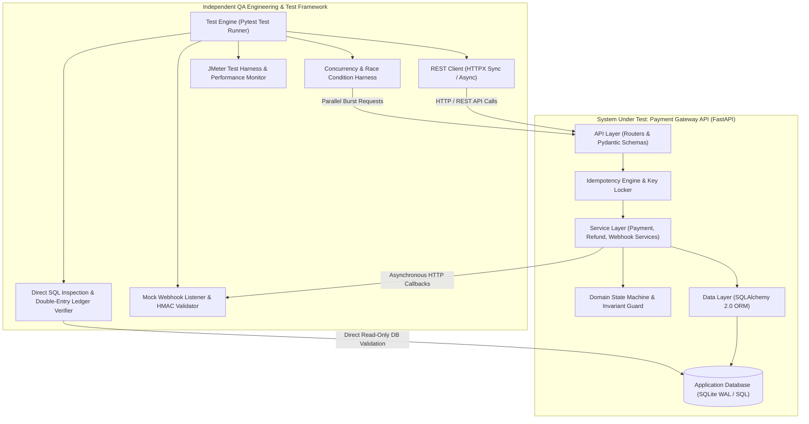
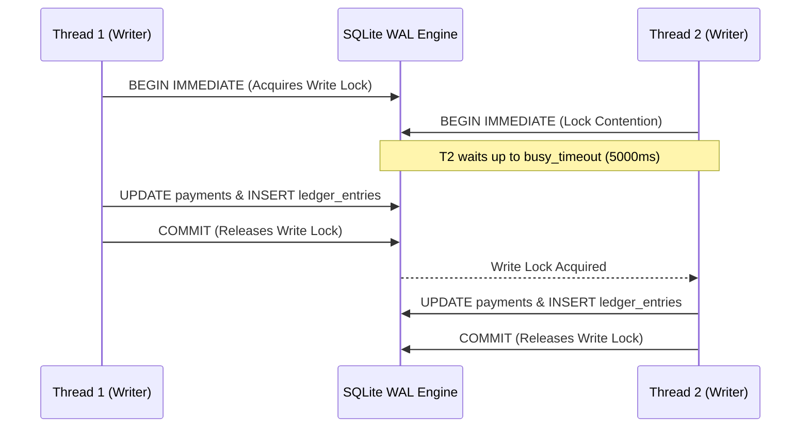
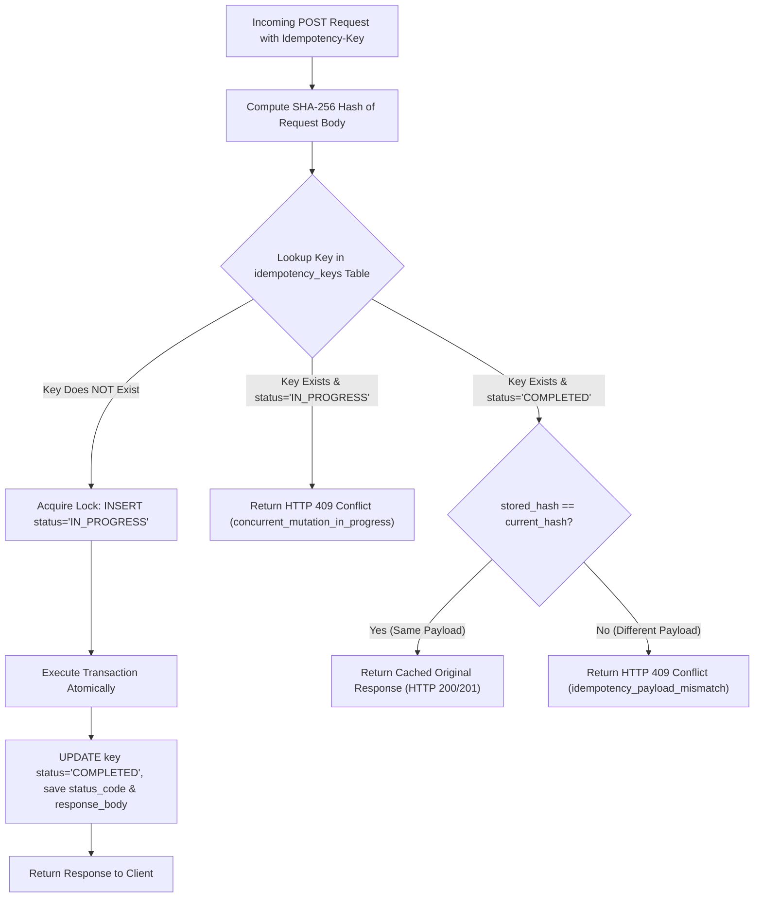
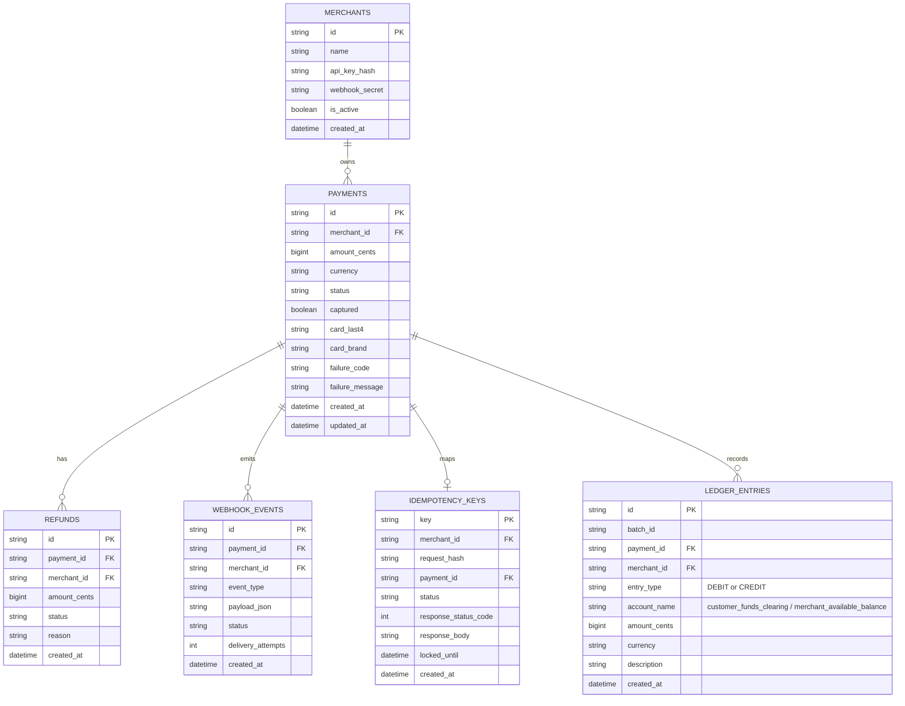

# 02 - System Architecture Document

**Document Version:** 1.1.0 (Post-Architecture Review Updates)  
**Status:** Approved Architecture Specification  
**Stack:** Python 3.12, FastAPI, SQLAlchemy 2.0, SQLite (WAL mode) / PostgreSQL-ready, Pytest  

---

## 1. High-Level Architecture & Separation of Concerns

The foundational design principle is the **strict architectural decoupling** of the **Payment Gateway (System Under Test - SUT)** from the **Independent Quality Engineering & Automated Testing Framework**.



### Architectural Isolation Principles:
1. **Decoupled Codebases:** `app/` is completely unaware of `tests/`. No test helper code or test bypasses reside in application modules.
2. **Black-Box Testing Boundary:** Tests communicate via HTTP protocols (`ASGITransport` or live network socket) to exercise real request serialization, headers, and middleware.
3. **Dual-Layer Verification (API + Database):** An HTTP `200 OK` is validated against direct SQL assertions, verifying that the physical database rows, idempotency records, and double-entry ledger entries match the expected states.

---

## 2. Concurrency Architecture & SQLite WAL Single-Writer Limitation

### 2.1 The SQLite WAL Concurrency Model
In SQLite with Write-Ahead Logging (`PRAGMA journal_mode=WAL`):
- **Concurrent Readers:** Any number of reader connections can query the database concurrently without blocking or being blocked by writers.
- **Single-Writer Limitation:** Only **one write transaction** can hold the database write lock at any given microsecond. If two threads initiate write transactions concurrently, the second thread will encounter a lock conflict.



### 2.2 How Concurrency Tests Handle Database Locking
1. **Engine Timeout (`busy_timeout=5000`):** Connections are initialized with a 5000ms busy timeout. When concurrent writes occur, SQLite automatically retries internally for up to 5 seconds before giving up.
2. **Immediate Transactions (`BEGIN IMMEDIATE`):** In SQLAlchemy, mutating sessions issue `BEGIN IMMEDIATE` at the start of the transaction. This prevents "lock upgrade deadlocks" (where two connections read concurrently and both try to upgrade to a write lock simultaneously).
3. **Controlled Conflict Responses:** If contention ever exceeds the timeout threshold under extreme burst conditions, the API translates `sqlite3.OperationalError: database is locked` into a clean **`HTTP 503 Service Unavailable`** or **`HTTP 409 Conflict`** rather than crashing.
4. **Production Contrast for Technical Interviews:** In a production distributed gateway, a multi-writer database like PostgreSQL or CockroachDB is used with row-level locks (`SELECT ... FOR UPDATE NOWAIT`) and distributed Redis locks. For this local simulation, SQLite WAL with `BEGIN IMMEDIATE` provides deterministic ACID guarantees without external infrastructure.

---

## 3. Precise Idempotency Specification



1. **Same Key + Same Payload:** Returns original transaction result immediately from cache. Zero duplicate charges, zero new ledger entries.
2. **Same Key + Different Payload:** Rejects with **`HTTP 409 Conflict`** and error code `idempotency_payload_mismatch`. Original transaction remains untouched.
3. **Different Keys:** Treated as completely independent transactions.

---

## 4. Relational Database Schema & Genuine Double-Entry Ledger

All monetary values are stored as **64-bit integers (`BIGINT`)** representing minor units (cents).



### 4.1 Genuine Double-Entry Ledger Invariant
Every transaction creates balanced entries in `ledger_entries` sharing a unique `batch_id`:
$$\sum_{\text{batch}} \text{Amount}_{\text{DEBIT}} = \sum_{\text{batch}} \text{Amount}_{\text{CREDIT}}$$

When \$50.00 is captured:
- Entry 1 (Batch `bat_01`): `entry_type = DEBIT`, `account_name = customer_funds_clearing`, `amount_cents = 5000`
- Entry 2 (Batch `bat_01`): `entry_type = CREDIT`, `account_name = merchant_available_balance`, `amount_cents = 5000`

When \$20.00 is refunded:
- Entry 1 (Batch `bat_02`): `entry_type = DEBIT`, `account_name = merchant_available_balance`, `amount_cents = 2000`
- Entry 2 (Batch `bat_02`): `entry_type = CREDIT`, `account_name = customer_funds_clearing`, `amount_cents = 2000`

---

## 5. Transactional Consistency Guarantee
All mutations across the 4 core entities (`payments`, `idempotency_keys`, `ledger_entries`, `webhook_events`) are bound to a single database transaction:
```python
try:
    # 1. Update Payment record
    # 2. Record balanced double-entry ledger entries
    # 3. Stage signed webhook event
    # 4. Finalize idempotency key to COMPLETED with cached response
    db.commit()
except Exception:
    db.rollback()
    raise
```
This guarantees zero orphaned records and zero ledger imbalances.
