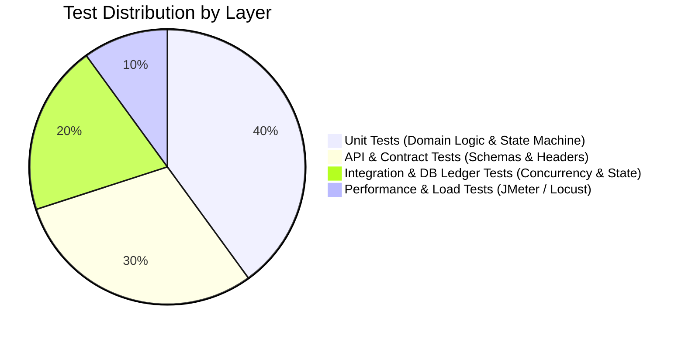

# 03 - Initial Test Strategy & Quality Plan

**Document Version:** 1.1.0 (Post-Architecture Review Updates)  
**Framework:** Pytest, HTTPX, Direct SQL Ledger Verification, JMeter  
**Philosophy:** Dual-Verification (API Contract + Double-Entry Ledger Consistency)  

---

## 1. Test Engineering Philosophy in Fintech

Testing payment gateways requires a specialized Quality Engineering methodology:
1. **The API Response is Not the Source of Truth:** A `200 OK` from an API endpoint is insufficient. The automated test must verify that physical SQL database rows, state transition logs, and double-entry ledger entries match the exact monetary units.
2. **Deterministic Simulation over External Mocks:** Rather than relying on flaky third-party sandboxes or random test generation, all card numbers, bank decline triggers, and error simulations are 100% deterministic.
3. **Concurrency is a First-Class Test Citizen:** In payment gateways, the most catastrophic bugs (double charges, race-condition overdrafts) happen under concurrent burst conditions. Concurrency tests are integral to the test suite, not an afterthought.

---

## 2. Test Pyramid & Scope

---

## 3. Test Matrix & Detailed Verification Scenarios

### 3.1 Idempotency & Concurrency Matrix (BR-01 & BR-05)

| Scenario ID | Test Description | Input Conditions | Expected Outcome | Verification Points |
| :--- | :--- | :--- | :--- | :--- |
| `TC-IDEM-01` | First-time payment | Valid payload, new UUID key | `HTTP 201 Created` | DB has 1 payment, 1 idempotency key (`COMPLETED`). |
| `TC-IDEM-02` | Immediate duplicate replay (Same key + Same payload) | Identical payload, same key | `HTTP 201 Created` (Cached) | DB payment count remains 1; identical response JSON returned. Zero duplicate ledger entries. |
| `TC-IDEM-03` | Conflicting payload replay (Same key + Different payload) | Altered amount/card, same key | `HTTP 409 Conflict` | Error `idempotency_payload_mismatch`; original payment record untouched. |
| `TC-IDEM-04` | Concurrent in-flight collision | Request arrives while key is `IN_PROGRESS` | `HTTP 409 Conflict` | Error `concurrent_mutation_in_progress`. |
| `TC-IDEM-05` | Concurrent burst (Race Condition) | 10 threads fire same key simultaneously | Exactly 1 `201 Created`, others get `201 Cached` or `409` | Exactly 1 payment created in DB; zero duplicate debits. |
| `TC-IDEM-06` | Concurrent conflicting capture | 2 threads attempt to capture same authorized payment | Exactly 1 succeeds (`200 OK`), other returns `409 Conflict` | Exactly 1 capture event in ledger. |

### 3.2 State Transition Matrix & Invalid Transition Assertions

```mermaid
stateDiagram-v2
    state "Valid Transitions" as Valid {
        CREATED_OK: CREATED --> AUTHORIZED
        AUTH_OK: AUTHORIZED --> CAPTURED
        AUTH_VOID: AUTHORIZED --> CANCELLED
        CAP_REFUND: CAPTURED --> REFUNDED
    }
    state "Illegal Transitions (Rejected with HTTP 409 Conflict)" as Invalid {
        INV_1: CREATED -x CAPTURED (Direct capture without auth)
        INV_2: CANCELLED -x CAPTURED (Cannot capture voided payment)
        INV_3: FAILED -x AUTHORIZED (Cannot authorize failed payment)
        INV_4: REFUNDED -x CAPTURED (Cannot recapture refunded payment)
        INV_5: CAPTURED -x CANCELLED (Must refund instead of cancel)
        INV_6: AUTHORIZED -x REFUNDED (Must cancel instead of refund)
    }
```

- Each illegal transition is covered by an automated test asserting **`HTTP 409 Conflict`** (`invalid_state_transition`) and confirming that the payment status remains unchanged.

### 3.3 Genuine Double-Entry Ledger Verification Matrix

For every financial mutation, the test framework executes direct SQL queries to assert the **double-entry ledger invariants**:

1. **Batch Balance Invariant:**
   $$\sum_{\text{entry} \in \text{batch}} \text{amount\_cents}_{\text{DEBIT}} = \sum_{\text{entry} \in \text{batch}} \text{amount\_cents}_{\text{CREDIT}}$$
2. **Merchant Available Balance Calculation:**
   $$\text{Merchant Available} = \sum \text{CREDIT}_{\text{merchant\_available\_balance}} - \sum \text{DEBIT}_{\text{merchant\_available\_balance}}$$
3. **Customer Clearing Balance Calculation:**
   $$\text{Customer Clearing} = \sum \text{DEBIT}_{\text{customer\_funds\_clearing}} - \sum \text{CREDIT}_{\text{customer\_funds\_clearing}}$$
4. **Global Balance Equation:**
   $$\sum_{\text{all}} \text{DEBIT} = \sum_{\text{all}} \text{CREDIT}$$

---

## 4. Concurrency Testing Strategy with SQLite WAL
- SQLite WAL mode is configured with `busy_timeout = 5000`.
- Pytest integration tests use `concurrent.futures.ThreadPoolExecutor(max_workers=10)` to send parallel bursts of HTTP requests against the SUT.
- The tests verify that all parallel transactions serialize within the 5-second window without raising unhandled `OperationalError: database is locked`.
