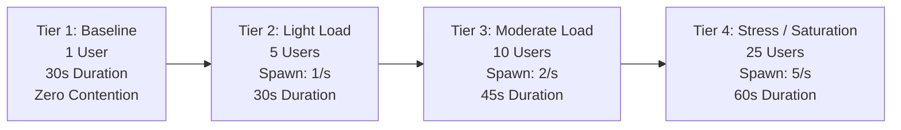

# 07 - Performance & Load Testing Plan

**Document Version:** 1.0.0  
**Phase:** Phase 4 – Performance and Load Testing  
**System Under Test (SUT):** Payment Gateway Simulator (FastAPI + SQLite WAL Mode + Integer Cents Ledger)  
**Primary Test Engines:** Locust 2.47.0 (Python-based distributed load engine) & Apache JMeter 5.6.3 (`.jmx` Enterprise Test Plan)  

---

## 1. Executive Summary & Objectives

The primary objective of Phase 4 is to rigorously evaluate the throughput, latency, concurrency resilience, and transactional data integrity of the Payment Gateway Simulator under synthetic multi-user load.

Unlike functional and integration testing, which validate deterministic input/output correctness, performance testing evaluates system behavior under concurrent resource contention:
1. **Establish a Single-User Baseline:** Quantify latency and throughput under zero contention.
2. **Measure Scalability Across Concurrency Profiles:** Evaluate performance at 1, 5, 10, and 25 concurrent virtual users.
3. **Verify Idempotency Under Load:** Measure cache hit latency versus cold database write latency.
4. **Stress Architectural Boundaries:** Observe SQLite WAL single-writer serialization and verify graceful `HTTP 503 database_busy` degradation without database corruption.
5. **Post-Load Data Integrity Audit:** Independently verify that every captured payment maintains an exact balanced double-entry ledger (`Total Debits == Total Credits`) with zero ghost records or duplicate payments.

---

## 2. System Architecture & Concurrency Model

### 2.1 Persistence Layer: SQLite WAL Single-Writer Limitation
The SUT uses SQLite configured in Write-Ahead Logging (`WAL`) mode with `PRAGMA busy_timeout = 5000` (5 seconds).
- **Concurrent Readers:** Unlimited simultaneous reads (`GET /v1/payments/{id}`, `GET /v1/merchants/{id}/ledger-summary`).
- **Serialized Writers:** All mutating transactions (`POST /v1/payments`, `/capture`, `/refund`) require exclusive write locks on the SQLite database.
- **Contention Behavior:** When multiple concurrent threads execute write operations simultaneously, SQLite queues writers up to the 5,000ms busy timeout. If contention exceeds this threshold, the application intercepts `OperationalError: database is locked` and returns a structured `HTTP 503 database_busy` with `retriable: true`, protecting the system from unhandled crashes (`HTTP 500`).

```
                +------------------------------------+
                |       Virtual Users (Locust)       |
                +-----------------+------------------+
                                  |
                                  v
                +------------------------------------+
                |   FastAPI Gateway (Uvicorn Async)  |
                +-----------------+------------------+
                                  |
               +------------------+------------------+
               |                  |                  |
               v                  v                  v
        [Idempotency]      [Payment FSM]      [Double-Entry]
        Key Validation      State Checks       Ledger Engine
               |                  |                  |
               +------------------+------------------+
                                  |
                                  v
                      +-----------------------+
                      |  SQLite Engine (WAL)  |
                      |  Single Writer Lock   |
                      |  busy_timeout = 5000ms|
                      +-----------------------+
```

---

## 3. Test Scenarios & Workload Distribution

The performance suite executes a realistic blended workload distributed across six distinct operational patterns:

| Scenario ID | Name | Method & Endpoint | Payload / Behavior | Weight | Success Criteria |
| :--- | :--- | :--- | :--- | :---: | :--- |
| **SCN-01** | Direct Payment | `POST /v1/payments` | Single-step Auth & Capture (`capture=True`, \$10-\$200) | 30% | `HTTP 201`, status `CAPTURED` |
| **SCN-02** | Two-Step Auth & Capture | `POST /v1/payments` $\to$ `POST /v1/payments/{id}/capture` | Pre-auth hold (`capture=False`) followed by capture | 20% | `HTTP 201` $\to$ `HTTP 200`, status `CAPTURED` |
| **SCN-03** | Full Lifecycle | `POST /v1/payments` $\to$ `/capture` $\to$ `/refund` | Auth $\to$ Capture $\to$ Partial Refund (\$30.00) | 15% | `HTTP 201` $\to$ `HTTP 200` $\to$ `HTTP 200` (`PARTIALLY_REFUNDED`) |
| **SCN-04** | Idempotency Replay | `POST /v1/payments` (Replayed) | Identical payload and same `Idempotency-Key` sent twice | 15% | `HTTP 201` on 1st & 2nd call, exact same ID returned, cached latency < cold latency |
| **SCN-05** | Distinct Key Bursts | `POST /v1/payments` (x2) | Rapid consecutive transactions with unique UUID keys | 10% | `HTTP 201`, 2 independent payment entities created |
| **SCN-06** | Expected Errors & Declines | `POST /v1/payments` | Amount < 50¢ (400), Bad Currency (400), Insufficient Funds (402) | 10% | `HTTP 400` or `HTTP 402` with valid structured error envelope (recorded as successful assertions) |

---

## 4. Concurrency Load Profiles

Testing progresses through four strictly controlled load tiers:



1. **Tier 1: Baseline (1 Concurrent User)**
   - **Users:** 1 | **Ramp-up:** Immediate | **Duration:** 30s
   - **Goal:** Measure raw, uncontented execution latency and baseline RPS for every scenario.
2. **Tier 2: Light Load (5 Concurrent Users)**
   - **Users:** 5 | **Ramp-up:** 1 user/s | **Duration:** 30s
   - **Goal:** Verify thread safety, initial concurrency scaling, and zero lock failures.
3. **Tier 3: Moderate Load (10 Concurrent Users)**
   - **Users:** 10 | **Ramp-up:** 2 users/s | **Duration:** 45s
   - **Goal:** Evaluate SQLite WAL lock queueing under moderate write pressure.
4. **Tier 4: High Load / Contention Boundary (25 Concurrent Users)**
   - **Users:** 25 | **Ramp-up:** 5 users/s | **Duration:** 60s
   - **Goal:** Push write concurrency past lock thresholds to observe timeout behavior, measure p99 latency spikes, and confirm application resilience (no 500 errors, zero data corruption).

---

## 5. Performance Metrics & SLA Targets

| Metric | Baseline Target (1 User) | Moderate Target (10 Users) | Description |
| :--- | :---: | :---: | :--- |
| **Throughput (RPS)** | $\ge 25$ req/s | $\ge 50$ req/s | Aggregate requests served per second |
| **Median Latency (p50)** | $< 35$ ms | $< 75$ ms | 50th percentile response time |
| **95th Percentile (p95)**| $< 75$ ms | $< 250$ ms | 95th percentile response time |
| **99th Percentile (p99)**| $< 120$ ms | $< 500$ ms | Tail latency under lock queuing |
| **Error Rate (5xx)** | $0.0\%$ | $< 1.0\%$ | Unhandled 500 errors must be exactly 0.0% |
| **Ledger Invariant** | $100\%$ Balanced | $100\%$ Balanced | Total Ledger Debits must exactly equal Total Credits |
| **Idempotency Invariant** | Zero Duplicates | Zero Duplicates | Duplicate keys must never generate duplicate payment records |

---

## 6. Execution Command Reference

### 6.1 Starting the System Under Test (SUT)
```powershell
.\.venv\Scripts\uvicorn.exe app.main:app --host 127.0.0.1 --port 8000 --log-level warning
```

### 6.2 Executing Locust Load Tests (Headless)
```powershell
# Tier 1: Baseline (1 User, 30s)
.\.venv\Scripts\locust.exe -f tests/performance/locustfile.py --headless -u 1 -r 1 -t 30s --host http://127.0.0.1:8000 --csv=tests/performance/results/baseline_1u

# Tier 2: Light Load (5 Users, 30s)
.\.venv\Scripts\locust.exe -f tests/performance/locustfile.py --headless -u 5 -r 1 -t 30s --host http://127.0.0.1:8000 --csv=tests/performance/results/load_5u

# Tier 3: Moderate Load (10 Users, 45s)
.\.venv\Scripts\locust.exe -f tests/performance/locustfile.py --headless -u 10 -r 2 -t 45s --host http://127.0.0.1:8000 --csv=tests/performance/results/load_10u

# Tier 4: Stress Contention (25 Users, 60s)
.\.venv\Scripts\locust.exe -f tests/performance/locustfile.py --headless -u 25 -r 5 -t 60s --host http://127.0.0.1:8000 --csv=tests/performance/results/stress_25u
```

### 6.3 Post-Test Data Integrity Verification Script
After each test run, run the dedicated verification script:
```powershell
.\.venv\Scripts\python.exe scripts/verify_performance_integrity.py
```
