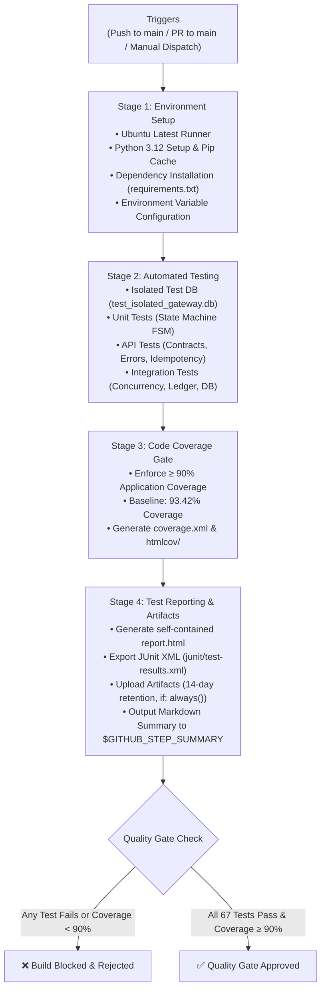

# 09 - CI/CD Pipeline & Automated Quality Gates Specification

**Document Version:** 1.0.0  
**Phase:** Phase 5 – CI/CD and Automated Quality Gates  
**System:** Payment Gateway Reliability & Quality Engineering Framework  
**CI/CD Orchestrator:** GitHub Actions  
**Workflow File:** [qa-pipeline.yml](file:///c:/Users/Logesh/Documents/payment-gateway-qa-framework/.github/workflows/qa-pipeline.yml)  

---

## 1. Executive Summary & Architecture

Phase 5 establishes a continuous integration and automated quality gate pipeline that ensures no code modifications can be merged into production without passing 100% of the independent automated QA regression suite, satisfying strict code coverage thresholds, and preserving test artifacts.

### 1.1 CI/CD Pipeline Architecture Diagram



---

## 2. Workflow Triggers & Execution Rules

The workflow `.github/workflows/qa-pipeline.yml` is configured with three distinct triggers:

| Trigger Event | Target / Scope | Operational Purpose |
| :--- | :--- | :--- |
| `push` | `branches: [ main ]` | Continuous integration guard ensuring `main` remains healthy and deployable. |
| `pull_request` | `branches: [ main ]` | Mandatory PR quality gate before code review or merge approval. |
| `workflow_dispatch` | Manual execution | On-demand ad-hoc testing directly from the GitHub Actions console. |

### Separation of Concerns: Regression vs. Performance
To maintain fast, deterministic, non-blocking CI feedback:
- The default GitHub Actions pipeline executes the **functional and integration regression test suite** (67 automated tests executing in under 3 seconds).
- Performance and load tests (Locust / JMeter) are kept separate and decoupled, preventing resource contention or runner throttling from causing intermittent CI timeouts.

---

## 3. Pipeline Stages & Execution Flow

### Stage 1: Environment Setup
- **Base Image:** `ubuntu-latest`
- **Runtime:** `actions/setup-python@v5` configured with Python `3.12` and pip dependency caching (`cache: 'pip'`).
- **Dependencies:** Installs frozen packages from `requirements.txt`.
- **Environment Configuration:**
  - `PYTHONPATH=.` (enables root package resolution)
  - `ENVIRONMENT=test`
  - `SQLITE_BUSY_TIMEOUT_MS=5000`

### Stage 2 & 3: Automated Testing & Code Coverage Quality Gate
The test runner executes the complete regression suite via Pytest:
```bash
pytest tests/unit tests/api tests/integration \
  -v \
  --tb=short \
  --cov=app \
  --cov-report=term-missing \
  --cov-report=xml:coverage.xml \
  --cov-report=html:htmlcov \
  --cov-fail-under=90 \
  --html=report.html \
  --self-contained-html \
  --junitxml=junit/test-results.xml
```

#### Coverage Baseline & Threshold Enforced:
- **Application Baseline:** **93.42%**
- **Strict Quality Gate Threshold:** **$\ge 90.0\%$** (`--cov-fail-under=90`)
- If application modifications drop test coverage below 90%, the build automatically terminates with a non-zero exit code, blocking deployment.

### Stage 4: Test Reporting & Artifact Preservation
- **HTML Report:** Generated as a standalone, zero-dependency `report.html` containing interactive test breakdown, timings, and error traces.
- **JUnit XML Report:** Exported to `junit/test-results.xml` for native GitHub Actions test summary visualization.
- **Coverage Reports:** Both Cobertura XML (`coverage.xml`) and interactive HTML directory (`htmlcov/`) are saved.
- **Artifact Upload:** Utilizes `actions/upload-artifact@v4` with `if: always()`. Crucially, even if tests fail, all diagnostic reports are preserved and available for developer download.

---

## 4. Automated Quality Gates

The pipeline enforces four non-negotiable quality gates:

```
+-----------------------------------------------------------------------+
|                       STRICT QUALITY GATES                            |
+-----------------------------------------------------------------------+
| 1. Zero Test Regressions  : 100% of 67 automated test cases must PASS |
| 2. Code Coverage Minimum  : Application coverage must be >= 90.0%     |
| 3. Zero Corrupt Invariants: Hardware-level read-only SQL validation  |
| 4. Clean Build            : Zero dependency or syntax failures        |
+-----------------------------------------------------------------------+
```

---

## 5. How to Inspect Test Results & Artifacts

### 5.1 In the GitHub Actions UI:
1. Navigate to the **Actions** tab in your GitHub repository.
2. Select the latest run of **Payment Gateway QA Automation & Reliability Pipeline**.
3. Under the **Summary** tab, view:
   - The interactive markdown table rendered via `$GITHUB_STEP_SUMMARY`.
   - The test execution time and step-by-step logs.
4. Scroll down to the **Artifacts** section:
   - Download `qa-test-and-coverage-reports.zip`.
   - Open `report.html` in any browser for interactive test inspection.
   - Open `htmlcov/index.html` to inspect line-by-line coverage metrics.

---

## 6. GitHub Integration & Repository Setup Instructions

The local project has been prepared for GitHub integration:
1. `.gitignore` is configured to prevent committing virtual environments, temporary SQLite databases, or byte-code.
2. The workflow file is staged at `.github/workflows/qa-pipeline.yml`.

### Step-by-Step Publishing & First Execution Guide:
To connect this project to a remote GitHub repository and trigger the first live CI run:

```bash
# 1. Initialize local Git repository (if not already initialized)
git init -b main

# 2. Stage all project files, test suites, and workflows
git add .

# 3. Create initial baseline commit
git commit -m "feat(ci): implement automated QA regression pipeline and quality gates"

# 4. Link to your GitHub remote repository
git remote add origin https://github.com/<YOUR_ORGANIZATION_OR_USERNAME>/payment-gateway-qa-framework.git

# 5. Push to GitHub main branch to trigger the pipeline
git push -u origin main
```

Upon pushing to `main`, GitHub Actions will immediately trigger the `qa-quality-gate` job and execute all 67 test cases.
